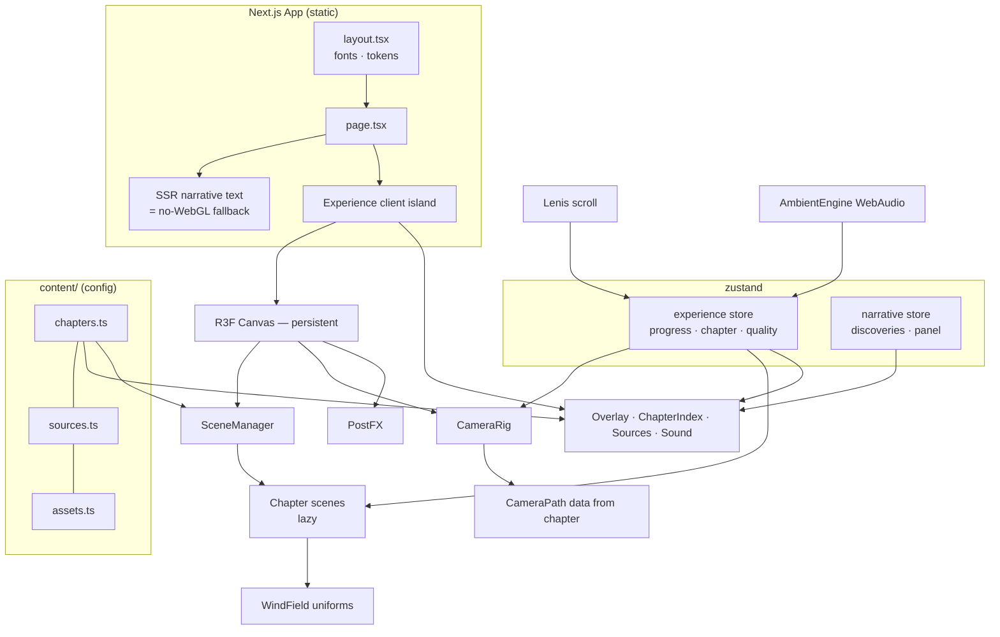
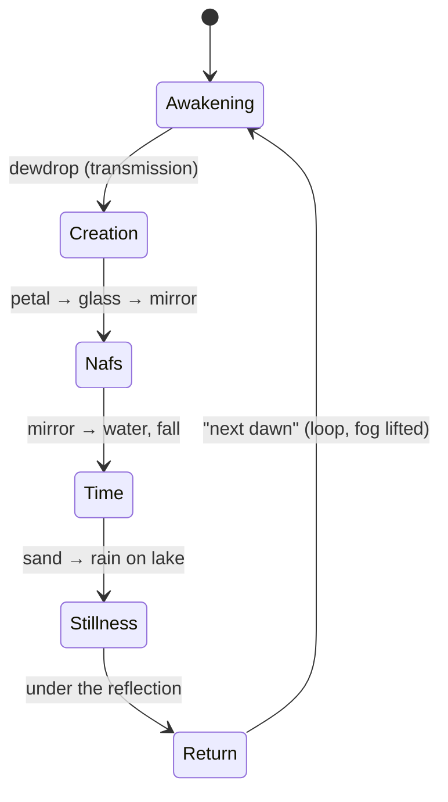
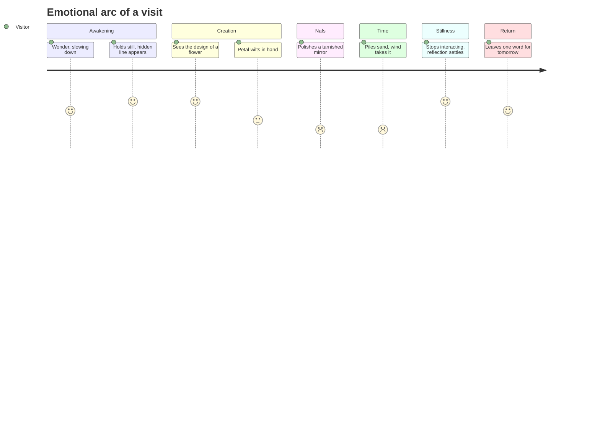
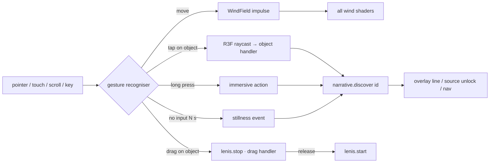
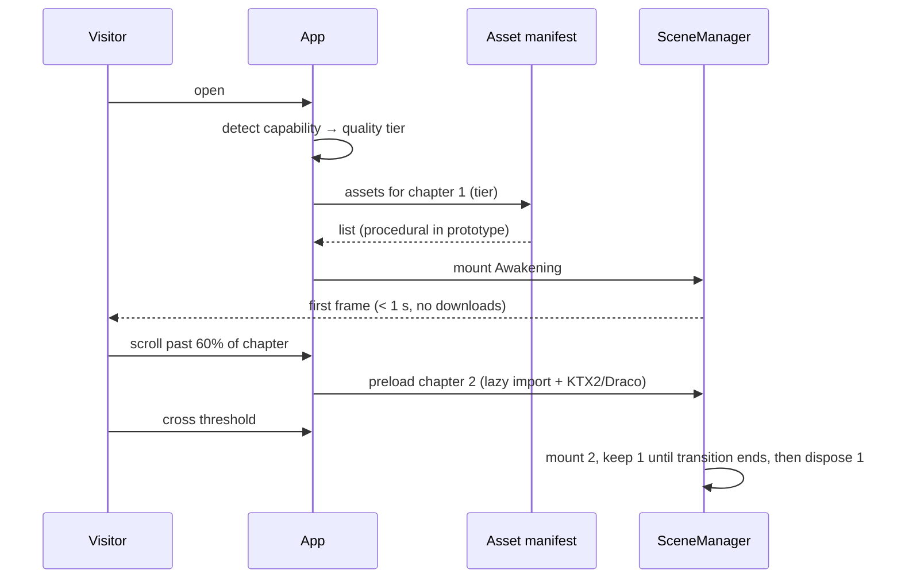

# SIRR — Project Proposal

> *"İnsan, kendine doğru yaptığı yolculukta Rabbine ne kadar yaklaşabilir?"*

Status: Phase 1 + 2 deliverable, with a working Phase 3 prototype (Chapter 01 — Awakening) in `/src`.

**Honesty note on the research.** The working folder was empty: no repository, no assets, no prior work. The studio and technique analysis below comes from my existing knowledge of these studios' public work and of the Three.js ecosystem. I did **not** browse live sites in this session. The religious references are listed with exact verse and hadith numbers in [`02-RESEARCH-REFERENCES.md`](02-RESEARCH-REFERENCES.md). Each one has a verification status, and Turkish meal text is **deliberately not pasted** (see that file for why).

---

## 1. Creative interpretation

*Sirr* in the Sufi vocabulary is the innermost layer of the heart: deeper than *qalb* (heart) and *rûh* (spirit), the place where a servant is alone with their Lord. A website called SIRR should not *explain* that place. It should *slow the visitor down* until they notice that they have one.

The thesis of the whole experience is a pair of verses that the project never shows on screen as decoration. They are the reason every scene is made of nature and self:

- **Fussilat 41:53** — signs *in the horizons* (âfâk) and *in themselves* (enfüs).
- **Adh-Dhariyat 51:20–21** — signs in the earth, *and in yourselves: do you not see?*

So the world of SIRR has two layers that always mirror each other:

| Outer (âfâk) | Inner (enfüs) |
|---|---|
| Dawn light | Awareness |
| A flower's anatomy | One's own created form (ahsen-i takvîm) |
| A mirror / water | The heart that can be polished or rusted |
| Wind erasing footprints | The 'asr — time running out |
| A still lake | A heart at rest in remembrance |
| Sunrise again | Return, and the journey starting again |

The answer to the central question is in **Qaf 50:16** ("We are closer to him than his jugular vein"). The visitor is not walking *toward* a distant God. They are walking toward *noticing*. The final chapter does not claim arrival. It returns the visitor to a new dawn.

### Name

**Keep SIRR** as the name. It is short, works in Arabic, Turkish and Persian, and fits a "discovered, not declared" experience. Suggested Turkish subtitle: **"SIRR — bir iç seyir"**.

Alternatives considered:
- **SEYR**: from *seyr ü sülûk*, the wayfaring of the soul. Very accurate, but less mysterious.
- **ÂYİNE**: Ottoman Turkish for mirror. Al-Ghazâlî's heart-as-mirror metaphor (Ihyâ, Book 21) sits at its centre. A strong name, but narrower.
- **NEFES**: breath. Universal, but too close to wellness branding.

---

## 2. Three creative directions

### A — "Tek Gün / One Day"
The whole journey is **one day, from pre-dawn to the next dawn**, in one continuous landscape. Each chapter is a time of day. Time itself carries the story, which echoes the oath *"Ve'l-'asr"* (103:1), where *'asr* means both "time/epoch" and "the afternoon" in the tafsir tradition.
- Strength: one continuous world, no scene cuts, and the sense of a lifetime passing.
- Weakness: one landscape can feel samey. The Nafs chapter needs an interior.

### B — "Âyine / The Mirror"
Every chapter is entered **through a reflective surface**: a dewdrop, a petal of glass, a mirror, water, a lake. Built around the image of the heart as a mirror (Ghazâlî, Ihyâ Book 21; Rûmî's story of the Chinese and Rûmî painters, Mesnevî I) and the hadith about the stain on the heart (*rân*, Tirmidhî 3334).
- Strength: transitions *are* the meaning, and portal tech becomes storytelling.
- Weakness: repeating "go through glass" five times gets predictable.

### C — "Tohum / The Seed"
The visitor follows **a seed**: soil, sprout, flower, wilting, seed again. Creation, growth, decay and return, at macro scale.
- Strength: very organic, gentle, and universal.
- Weakness: the seed is a poor vehicle for the ego (Nafs) and for accountability. There is a risk of turning into a nature documentary.

### Recommended: **A + B — "One day, five thresholds"**
A single day carries the time arc. Each chapter change is a **reflective threshold**, a different material every time, so it never repeats:

| # | Chapter | Time of day | Threshold out |
|---|---|---|---|
| 01 | Uyanış / Awakening | Blue hour → first light (before fajr) | camera falls into a **dewdrop** on the hero flower |
| 02 | Yaratılış / Creation | Morning, macro | light passes through a **translucent petal** that turns into polished glass |
| 03 | Nefs / The Self | Interior "noon" — no true shadows | the **mirror becomes water**, and we fall through it |
| 04 | Zaman / Time | 'Asr (late afternoon), long shadows on sand | sand grains slow and become **raindrops on a lake** |
| 05 | Sükûn / Stillness | Dusk → night, stars reflected | camera dips **under the lake's reflection** and comes out into sky |
| 06 | Dönüş / Return | Fajr again, sunrise | no threshold: the horizon stays open |

The day starts before fajr and ends at fajr. **Al-Fajr (89)** is where the "nafs al-mutma'inna" verses live, so the circle closes on a new beginning, not on an arrival.

---

## 3. The narrative journey

The structure follows the classical three-fold reading of the nafs, without naming it on screen until the visitor opens a source panel:

- *nefs-i emmâre*, the soul that commands to evil (Yûsuf 12:53) → Chapter 03
- *nefs-i levvâme*, the self-reproaching soul (Al-Qiyâma 75:2) → Chapters 03–04
- *nefs-i mutmainne*, the soul at rest (Al-Fajr 89:27) → offered as **hope and invitation**, Chapter 06

The emotional arc runs: wonder → dignity → discomfort → urgency → rest → hope with responsibility.

Each chapter has four layers. All of them are configured in `src/content/chapters.ts`:

1. **World**: what is seen and heard.
2. **Question**: original project writing, in Turkish, always labelled `original`.
3. **Gesture**: one main interaction that *embodies* the question.
4. **Source** (opt-in panel): Quran reference, tafsir note, hadith, scholar, each with its type label.

### 01 — Uyanış (Awakening)
- **World:** A wide valley in blue-hour fog. A field of grass and small wildflowers in the wind. One flower close to the camera. Pollen and dust hang in the air. The horizon starts to glow.
- **Questions:** "Ne zamandır buradasın?" · "Yaşıyor musun, yoksa yalnızca geçiyor musun?" · "En son ne zaman gerçekten durdun?"
- **Gesture:** *Stopping.* Moving the pointer makes wind. **Holding still** for a few seconds makes the wind calm, the light rise a little, and a hidden line appear: "Durduğunda, dünya da durdu mu — yoksa ilk kez mi gördün?" Touching the flower makes it shiver and release a petal.
- **Source (hidden):** Fussilat 41:53, Dhariyat 51:20–21. Nothing religious is visible unless the visitor opens it.
- **Threshold:** a dewdrop on the hero flower. The camera dives into it and the frame fills with refracted morning.

### 02 — Yaratılış (Creation) — At-Tîn 95
- **World:** Macro scale. Petals the size of cathedral walls, with veins, translucency and subsurface glow. Pollen drifts like slow stars.
- **Question:** "Bu kadar incelikle yaratılmışken, kendine ne yapıyorsun?"
- **Gesture:** *Seeing the design.* Dragging a petal rotates the flower and reveals its symmetry. A long press turns on "anatomy light", where the veins glow, showing order (*takvîm*).
- **Narrative honesty:** At-Tîn is **not** "you are wonderful". It is *ahsen-i takvîm* (95:4), **then** *esfel-i sâfilîn* (95:5), **except** those who believe and do good (95:6), and *"Is Allah not the most just of judges?"* (95:8). So the chapter ends with the same petal **wilting** in the visitor's hand. Dignity is a trust, not a possession.
- **Threshold:** the wilted petal's surface hardens into glass and becomes a mirror.

### 03 — Nefs (The Self)
- **World:** A dark, beautiful, endless reflective floor. A single tall mirror. Shadows move a moment out of sync with the visitor's movement, like a self that doesn't quite obey.
- **Questions:** "Kendine anlattığın hikâyenin ne kadarı gerçek?" · "İstediğin her şey, gerçekten ihtiyacın olan şey mi?" · "En çok neyi kaybetmekten korkuyorsun?"
- **Gesture:** *Polishing.* The mirror starts out fogged and tarnished. Dragging across it **clears it**, but slowly, and the stain partly returns when you stop. This embodies the *rân* hadith (Tirmidhî 3334) and Rûmî's painters story: the heart is polished, not painted. When it is clear enough, the surface turns to water under the visitor's touch.
- **Tone:** questions with no verdicts and no "sin" language on screen. The *levvâme* soul blames itself. The experience must not do the blaming for it.
- **Threshold:** through the water-mirror. The visitor falls, and lands on sand.

### 04 — Zaman (Time) — Al-'Âdiyât 100, At-Tekâsür 102, Al-'Asr 103
- **World:** Desert at 'asr. Long shadows, moving sand, wind. A line of footprints ahead. Far away, a glinting object the visitor keeps "almost" reaching.
- **Questions:** "Ömrünü neye harcıyorsun?" · "Biriktirdiklerinin hangisi seninle gelecek?" · "Yetişmeye çalışırken neyi kaçırıyorsun?"
- **Gestures:** Scrolling faster makes the sun move faster. **Dragging gathers sand into a pile, and the wind takes it back.** This is *tekâsür*, piling up. The footprints the visitor leaves dissolve behind them.
- **Narrative honesty:** Al-'Âdiyât's oath is about **charging war-horses** (100:1–5). It is then about **man's ingratitude** (*kenûd*, 100:6), his witness against himself (100:7, with two tafsir views on who the witness is), and his **intense love of wealth** (*hayr*, 100:8), which ends at the graves being emptied (100:9–11). The design uses horses only as **sound and motion in the wind** (distant hoofbeat-like gusts, galloping dust), never as illustration. The "piling" interaction carries At-Tekâsür, and the afternoon light carries Al-'Asr.
- **Threshold:** sand grains slow in mid-air and become raindrops falling on a lake.

### 05 — Sükûn (Stillness) — Ar-Ra'd 13:28
- **World:** A lake at dusk, a single tree, then stars mirrored on the water. Almost no movement.
- **Gestures:** Tap the water for ripples. **Stay still** and the ripples settle, the reflection becomes perfect, and a line appears. The chapter rewards *not interacting*. A soft breathing rhythm of light (about 6 breaths/min) is offered, but it is never called "meditation".
- **Content:** Ar-Ra'd 13:28 (hearts at rest in *zikr*). Gratitude and patience (Muslim 2999: the believer's affair is good in both). Al-Ghazâlî on *sabr* and *şükr* (Ihyâ Book 32).
- **Threshold:** the camera dips under the reflection. Up and down swap, and the visitor rises into a dawn sky.

### 06 — Dönüş (Return) — Al-Fajr 89:27–30, Al-Hashr 59:18
- **World:** Sunrise over an open landscape, the same valley as Chapter 01 but now clear. The hero flower is there again. It is a different flower, because time passed.
- **Questions:** "Bugün neyi değiştirebilirsin?" · "Kalbini neye yöneltiyorsun?" · "Yolculuğuna nereden devam edeceksin?"
- **Gesture:** The visitor can leave **one word** for themselves (stored only locally, never sent) and is told it will be waiting at the next dawn. Al-Hashr 59:18: "let every soul look to what it has sent forth for tomorrow."
- **Honesty:** 89:27–30 is addressed (per tafsir) at death or on the Day of Judgment. The site presents it as **what is hoped for**, never as something the visitor has reached. The last screen is not "the end". It is the first frame of Chapter 01, with the fog lifting.

---

## 4. Camera language

| Chapter | Camera behaviour |
|---|---|
| Awakening | Slow dolly-in at knee height through grass (~1.4 m/s at full scroll speed). Slight handheld noise (0.3°). Shallow depth of field, focused on the hero flower in the last third. |
| Creation | Macro "insect flight": orbit plus pass-throughs, very long lens (FOV 25°), focus pulls between veins. |
| Nefs | Locked-off and symmetric. The camera only moves **toward** the mirror, with an uncomfortable centred composition. The reflection camera is mirrored. |
| Time | Wide lens (FOV 60°), lateral tracking along the footprints. Scroll speed is mapped to time-lapse. |
| Stillness | Almost static. Movement decays toward zero when the user is idle. Tilt down onto the water. |
| Return | A rising crane shot reveals the whole valley. FOV widens slowly from 35° to 50°. |

The system behind it:
- One persistent `PerspectiveCamera`. Each chapter supplies a **CatmullRom spline** for position plus a second spline for look-at targets. FOV and focus distance are keyed along the same parameter.
- Scroll is normalised to `progress ∈ [0,1]` per chapter, then **critically damped** (`THREE.MathUtils.damp`), so a trackpad flick feels like inertia, not a jump.
- Pointer adds a small look-offset (±3° yaw, ±2° pitch) with its own damping. It turns off under `prefers-reduced-motion`.
- Thresholds are timed in the **camera's own parameter** (e.g. t > 0.88 means "inside the dewdrop"). The transition is therefore part of the shot, not an overlay.

---

## 5. Interaction system

All interactions run through one model, so each chapter only *declares* what it reacts to:

- **WindField** (a global singleton): direction, base strength, gust noise, and a **pointer impulse** (pointer velocity projected into the world). Exposed as one shared uniforms object. Every wind-reactive shader (grass, petals, pollen, cloth, hair cards) reads the *same* uniforms, so wind is coherent across the world.
- **Gestures** (`src/interactions`): `usePointerWorld`, `useLongPress`, `useStillness` (fires after N ms with no pointer, scroll or key input), and drag with `touch-action` control. While dragging an object, page scroll is suspended (Lenis `stop()`), so mobile drags don't scroll the page.
- **Discoveries:** any interaction can emit `discover(id)` into the narrative store. Discovered items unlock lines and source cards. Navigation shows only discovered chapters, plus "next".
- **Keyboard:** ↑/↓/PageUp/PageDown/Space scroll, `S` sound, `K` sources (kaynaklar), `Esc` closes panels, and number keys jump to discovered chapters.
- **Hair & cloth (Ch. 06 silhouette):** **no** strand simulation. Use hair *cards* (alpha-textured strips) and cloth with a **vertex shader driven by the same WindField** plus a per-vertex pin weight (painted in Blender as vertex colour). This is convincing at silhouette distance and costs nothing extra on mobile. Real verlet cloth (a ~32×32 grid on the CPU) is kept as an optional desktop-only upgrade.

---

## 6. Visual identity

- **Palette** (`src/styles/tokens.css`): ivory `#F4EEE2`, cream `#E8DDC8`, sage `#A7AE94`, olive `#6E7256`, earth `#4A3B2C`, dusty rose `#C9A3A0`, pale gold `#D8BE87`, deep shadow `#15130F`. No purple.
- **Type:** *Cormorant Garamond* (editorial serif, full Turkish support: ğ ş ı İ ç ö ü) for statements, and *Inter* for UI. Both are OFL and loaded via `next/font`, self-hosted at build time.
- **Text on screen:** never more than one sentence at a time. It appears with a slow blur-to-sharp and letter-spacing settle (1.2 s) and leaves *before* the next one arrives. Silence between lines is part of the design.
- **UI:** four elements in total: a chapter index (thin line marks), a sound toggle, a "Kaynaklar" (sources) button, and a scroll hint. No cards, no glassmorphism. Panels are flat ivory on deep shadow, set like book typography.
- **Grade:** filmic (ACES) tone mapping, warm highlights, slightly lifted blacks, fine grain, a subtle vignette, and mild bloom only on light sources.

---

## 7. Technical architecture & decisions

### Stack

| Choice | Why |
|---|---|
| **Next.js (App Router) + TypeScript** | Statically exported shell. Server-rendered **text fallback** (the whole narrative is readable without WebGL, which matters for accessibility and SEO). `next/font`. Per-route code splitting for a future `/kaynaklar` page. |
| **three + @react-three/fiber** | A declarative scene graph that fits a config-driven chapter system. Integrates cleanly with React state for the UI layer. |
| **@react-three/drei** | Used narrowly: `useGLTF`/`useKTX2` (later), `MeshTransmissionMaterial` (glass/dewdrop thresholds), `PerformanceMonitor` (adaptive quality), `AdaptiveDpr`. |
| **@react-three/postprocessing** | A single merged EffectComposer pass: Bloom, Vignette, Noise, optional DepthOfField (desktop "high" tier only). |
| **zustand** | Tiny, and readable from inside the render loop without re-rendering React (`getState()` in `useFrame`). |
| **lenis** | Smooth native scroll (keeps native scrollbar, accessibility, keyboard and touch momentum). Has `stop()`/`start()` for drag locking. |
| **GSAP / ScrollTrigger — *not yet*** | The camera is driven by one damped progress value per chapter, which a 20-line hook covers. Add GSAP when per-element timelines get complex (Ch. 04 time-lapse choreography). The same scroll store would feed it. |
| **No physics engine** | Nothing in the brief needs rigid bodies. Wind, petals and cloth are cheaper as shaders. |

### Module layout (implemented)

```
src/
  app/                 layout.tsx (fonts, persistent shell), page.tsx (SSR narrative + Experience)
  components/
    experience/        Experience.tsx (Canvas host), SceneManager.tsx, PostFX.tsx, WebGLFallback.tsx
    navigation/        ChapterIndex.tsx
    typography/        NarrativeOverlay.tsx
    ui/                SoundToggle.tsx, SourcesPanel.tsx, ScrollHint.tsx
  scenes/
    awakening/         AwakeningScene.tsx, Grass.tsx, Flowers.tsx, HeroFlower.tsx, Pollen.tsx, Sky.tsx, Ground.tsx, path.ts
    creation/ …        (Phase 4)
  camera/              CameraRig.tsx (spline + damping + pointer look)
  shaders/             wind.glsl.ts (shared GLSL chunk), sky, grass, petal, pollen shaders
  materials/           windUniforms.ts (shared WindField)
  interactions/        useStillness.ts, usePointerWorld.ts
  hooks/               useScrollProgress.ts, useReducedMotion.ts
  store/               experience.ts (progress, chapter, quality), narrative.ts (discoveries, panel)
  content/             chapters.ts (config: titles, beats, questions, sources by type), sources.ts
  audio/               AmbientEngine.ts (procedural WebAudio wind; no files)
  utils/               device.ts (capability detection → quality tier)
  styles/              tokens.css, globals.css
public/  models/ textures/ audio/  (empty in the prototype; see asset manifest)
docs/    01-PROPOSAL.md, 02-RESEARCH-REFERENCES.md, 03-ASSETS.md
```

### Key rules
- **Rendering ↔ narrative separation:** scenes never contain text. `chapters.ts` holds the *beats* (`at: 0.12 → line id`). The overlay reads progress from the store and renders lines. Questions or sources can change without touching any shader.
- **Camera ↔ scene separation:** a chapter exports a `CameraPath` (data only). `CameraRig` is the only code that moves the camera.
- **One Canvas, forever.** It is mounted in the layout and never unmounted, which avoids WebGL context churn. `SceneManager` mounts the **current + next** chapter (lazy `import()`) and disposes the others.
- **Asset manifest:** `content/assets.ts` lists every file with source, license and attribution, and drives preloading per chapter.

---

## 8. Diagrams

### Application architecture


### Scene transitions


### User journey


### Interaction flow


### Asset loading lifecycle


---

## 9. Dependencies

Runtime: `next`, `react`, `react-dom`, `three`, `@react-three/fiber`, `@react-three/drei`, `@react-three/postprocessing`, `postprocessing`, `zustand`, `lenis`.
Dev: `typescript`, `@types/*`.

Later, when real assets arrive: `gltf-transform` CLI (dev, Draco/Meshopt + KTX2 compression, not a runtime dependency). GSAP is optional, for Ch. 04 choreography.
Rejected: `cannon`/`rapier` (no rigid-body need), `theatre.js` (great for keyframing, but adds an editor and runtime; revisit if a motion designer joins), `leva` in production (dev-only at most).

---

## 10. 3D assets

See [`03-ASSETS.md`](03-ASSETS.md). Summary: **the prototype uses zero downloaded assets**. Flowers, grass, sky, fog, pollen and wind audio are all procedural, so there are no license risks and the first frame needs no downloads. Production needs a few hero assets that should be **custom-made in Blender** (hero flower in macro, the mirror, the silhouette with hair cards and cloth), plus CC0 HDRIs and textures from Poly Haven and ambientCG.

---

## 11. Performance & mobile

- **Tiers** (`utils/device.ts`): `low` (mobile, or `hardwareConcurrency ≤ 4`, or `deviceMemory ≤ 4`), `medium`, `high`. Each tier sets grass blade count (6k / 18k / 40k), wildflower count, pollen count, DPR cap (1.25 / 1.5 / 2), and post-FX (none or vignette only / bloom + vignette + grain / + DOF).
- `PerformanceMonitor` lowers the tier at runtime if FPS drops, and never raises it mid-chapter, which avoids popping.
- Instancing everywhere: grass, flowers and pollen are one draw call each, and all wind happens in the vertex shader. The prototype targets **< 30 draw calls**.
- Under `prefers-reduced-motion`: no camera noise, no pointer parallax, gentler wind, instant text, and scroll moves the camera without inertia.
- **No WebGL:** the SSR text journey renders as an elegant typographic page (it is the same content config).
- Assets later: KTX2/Basis textures, Draco/Meshopt geometry, ≤ 1024² textures on mobile, chapter-scoped preloading.

---

## 12. Milestones

| Phase | Deliverable | Exit criterion |
|---|---|---|
| 1–2 | This document, references, asset plan | Approved direction |
| **3** | **Awakening prototype** (in repo now) | Feels cinematic on desktop and mid-range phone; ≥ 50 fps desktop |
| 4a | Creation (macro petals, transmission dewdrop threshold) | Threshold reads as a camera move, not a cut |
| 4b | Nafs (mirror polish, reflector, water threshold) | Polish gesture feels physical on touch |
| 4c | Time (sand, footprints, time-lapse sun) | Sand pile and wind loop readable in under 5 s |
| 4d | Stillness (lake ripples, idle reward) | Visitors actually stop |
| 4e | Return (sunrise, silhouette, local "word for tomorrow") | Ending reads as a beginning |
| 5 | Integration, accessibility, audio design, device QA | Lighthouse a11y ≥ 95; no input traps |
| 6 | Production build, deployment (static, e.g. Vercel/Netlify), README | — |

---

## 13. Risks & challenges

| Risk | Mitigation |
|---|---|
| **Religious misrepresentation** | Every source has a type and a verification status. Meal text is inserted only from licensed or verified sources. A **qualified reviewer (ilahiyatçı)** should sign off on `sources.ts` before launch. *This is the one gate I can't close myself.* |
| Procedural flowers look "CG" | The hero flower in production is a Blender-sculpted model. Procedural is kept for the far field, where it's convincing. |
| Transmission glass is expensive (extra render pass) | Use only during thresholds, at reduced resolution, with `samples` lowered on mobile. Fallback: a refraction shader using a pre-captured env map. |
| Mobile GPU / thermal | Tiers, runtime downgrades, 30 fps cap option, and no DOF on mobile. |
| Scroll-jacking feels trapping | Native scroll (Lenis), a visible chapter index, Esc and keyboard always work, and a text-only route. |
| Audio autoplay | Sound starts only after an explicit tap on the sound toggle. Silence is the default and a deliberate choice. |
| Scope (6 worlds) | One chapter per milestone, each validated visually before the next is started. |

### Decisions I need from you
1. Direction **A+B "One day, five thresholds"**: approve, or pick A/B/C.
2. Can a theology reviewer be found for source sign-off?
3. Is a Blender artist available for the hero assets (flower, mirror, silhouette), or should I push procedural further?
